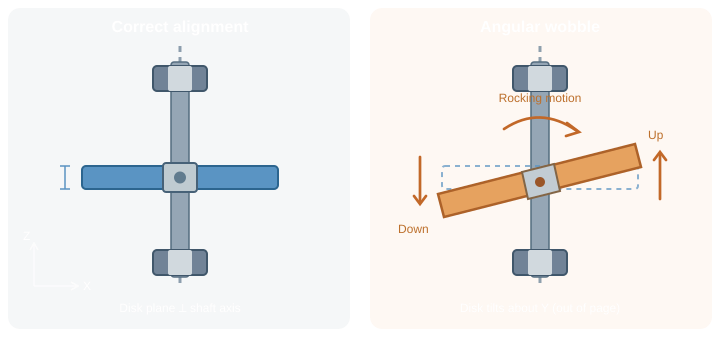

At this stage of the cycloidal drive, I am facing some issues with disk wobble. The disks seem to exhibit angular play about their in-plane axes (X and Y), allowing them to rock out of their nominal plane perpendicular to the eccentric shaft's rotational axis (Z).

So the eccentric shaft holding the 2 cycloidal disks is a 3-piece 3D-printed part. There might be some play due to the axle parts not being fastened tightly. One way to tackle that is to fasten the parts using screws. However I have reason to believe that the disks are over-constrained; the clearances for the output bore are too tight that the only way for those disks to rotate normally is to have that room in its plane-x plane-y tilt.
